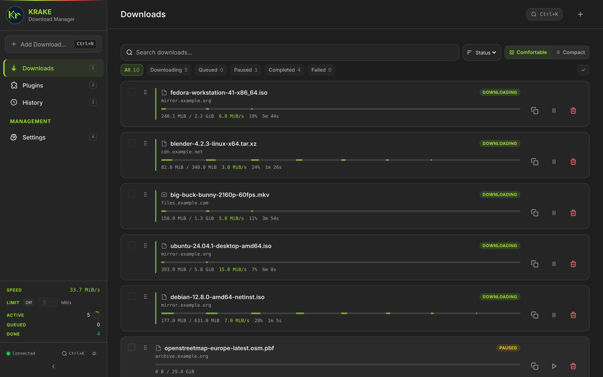

<!-- amigo-labs header: generated by amigo-labs/website scripts/readme-header.ts -->
<p align="center">
  <a href="https://amigo-labs.dev/krake/"></a>
</p>

<h1 align="center">Krake</h1>

<p align="center">
  <a href="https://amigo-labs.dev/krake/"></a>
  <a href="https://github.com/amigo-labs/amigo-krake/releases"></a>
  <a href="https://github.com/amigo-labs/amigo-krake/actions/workflows/ci.yml"></a>
  <a href="https://github.com/amigo-labs/amigo-krake/blob/main/LICENSE"></a>
  <a href="https://amigo-labs.dev/krake/"></a>
</p>
<!-- /amigo-labs header -->

A fast, modular download manager in Rust: multi-chunk HTTP, Usenet, HLS, DASH and YouTube, with TypeScript plugins. It runs as a server with a Web UI, as a desktop app, or from the command line.



## Quick start

```bash
docker run -d --name krake -p 1516:1516 \
  -v ./config:/config -v ./downloads:/downloads \
  -e KRAKE_BIND=0.0.0.0:1516 ghcr.io/amigo-labs/krake:latest
```

Open `http://localhost:1516`; the setup wizard creates the admin account.

Or the command line only (Linux and macOS):

```bash
curl -fsSL https://raw.githubusercontent.com/amigo-labs/amigo-krake/main/scripts/install.sh | bash
krake https://example.com/file.zip
```

## Documentation

For users, on [amigo-labs.dev/krake](https://amigo-labs.dev/krake/):

- [Install](https://amigo-labs.dev/krake/install/) — Docker, binaries, desktop app, building from source
- [Command line](https://amigo-labs.dev/krake/cli/)
- [Configuration](https://amigo-labs.dev/krake/configuration/)

For plugin authors and contributors, in this repository:

- [Plugin API](docs/plugin-api.md) and the [plugin template](plugins/template/plugin.ts)
- [Architecture](docs/architecture.md)
- [AGENTS.md](AGENTS.md) — repository layout, REST API, conventions, the spec-driven workflow

## Development

The build needs Rust (pinned in `rust-toolchain.toml`), Node.js with pnpm, `protoc`, and `clang` with a WebAssembly target (`apt-get install protobuf-compiler clang lld`). On macOS, `brew install protobuf llvm` and set `CC_wasm32_unknown_unknown` and `AR_wasm32_unknown_unknown` to Homebrew's `clang` and `llvm-ar`; Apple's clang has no WebAssembly target.

```bash
pnpm install && pnpm build:web-ui        # Web UI
cargo build --bin krake-plugin-host      # plugins run in this process
cargo run --bin krake-server             # server on http://127.0.0.1:1516
cargo test --workspace
cargo clippy --workspace --all-targets -- -D warnings
```

## License

MIT
